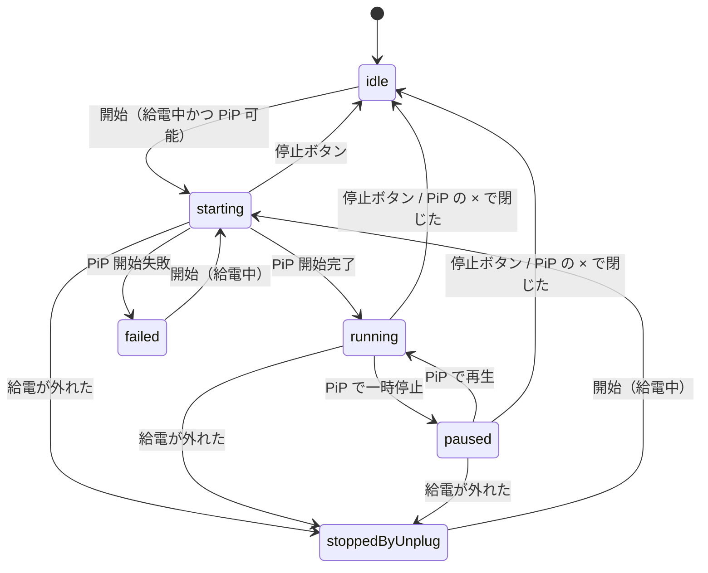

# pip-awake 設計

- 読み手: このリポジトリで実装する自分・エージェント
- 目的: 作るものの範囲・構成・状態遷移を固定し、実装計画（plans/）の根拠にする
- 状態: 2026-11-04 起票。チャットで方式と設計の合意済み。2026-11-05 改訂: PiP 窓を経過時間と給電状況だけの 640×180 表示に変更（ユーザー指示）。2026-11-04 改訂 2: 高さを 50 に縮め、経過時間と給電状況を HStack で横一列にした（ユーザー指示）

## 何を作るか

社有 iPhone は MDM で自動ロックが 1 分に固定されていて、自宅で開発端末として使うと
Xcode を触っている間に画面が消える。PiP（ピクチャインピクチャ）で時計を再生し続け、
動画再生中は画面をスリープさせない iOS の仕組みを使って画面を点けたままにする。

成功条件:

1. PiP を出したまま開発中のアプリを前面にして 2 分放置しても画面が消えない
2. PiP を画面端に寄せて隠した状態でも 1 と同じ
3. 給電ケーブルを抜くと PiP が消え、そこから 1 分で通常どおり自動ロックされる

含めないもの: 設定画面、無線デバッグ（ケーブルなし）での利用、ケーブル再接続での自動再開、
TestFlight / App Store 配信、CI。

## 前提と制約

| 項目 | 値 |
|---|---|
| 最低 OS | iOS 17.0（社有端末の OS が不明なため低めに置く。使う API は iOS 15 から） |
| 言語 | Swift 6（strict concurrency）、SwiftUI、Observation |
| プロジェクト生成 | XcodeGen（`project.yml`）。Parin と同じ |
| Bundle ID / Team | `dev.akidon.pipawake` / `XSC9AJPSP3`（個人チーム、自動署名） |
| 表示名 | Awake |
| 配布 | Xcode から社有端末へ直接インストールのみ |
| Capability | Background Modes の audio（PiP に必要） |
| オーディオセッション | `.playback` + `.mixWithOthers`（ほかのアプリの音を止めない） |
| 品質ツール | `.swiftlint.yml` / `.swift-format` / `.gitignore` を ios-project-template から流用 |

MDM の自動ロックは会社のセキュリティポリシーなので、使い始める前に情シスへ確認する。
給電中だけ動かすのは、端末を持ち出したら 1 分ロックに戻すための安全弁でもある。

## 方式

`AVSampleBufferDisplayLayer` に時計の画像を毎秒 enqueue し、
`AVPictureInPictureController` の sample buffer 用 content source で PiP に出す。
`AVSampleBufferDisplayLayer.preventsDisplaySleepDuringVideoPlayback` は iOS で既定 YES
（iPhoneOS 27.1 SDK のヘッダで確認）なので、再生中は画面スリープが抑止される想定。

| 方式 | 時計を出せるか | スリープ抑止 | 扱い |
|---|---|---|---|
| A. sample buffer に毎秒描画（本設計） | 現在時刻・経過時間とも出せる | 上記プロパティ | 採用 |
| B. 経過時間を焼き込んだ 1 時間動画を AVPlayer でループ | 経過時間のみ | AVPlayer の同名プロパティ。YouTube の PiP と同じ経路 | A が実機で効かなかったときの予備 |
| C. ビデオ通話用 PiP に SwiftUI ビューを表示 | 出せる | 再生扱いにならず根拠がない | 不採用 |

## 部品

| 部品 | 役割 | 依存 |
|---|---|---|
| `ElapsedFormatter` | 経過秒を `H:MM:SS` に整形する純関数 | なし |
| `ClockFrameRenderer` | 経過時間・給電状態から 640×50 の BGRA `CVPixelBuffer` を作る。SwiftUI の `ClockFrameView`（HStack）を `ImageRenderer` で画像にして流し込む。副作用なし | SwiftUI / CoreVideo |
| `ClockSampleBufferFeeder` | `AVSampleBufferDisplayLayer` と制御用タイムベースを持ち、1 秒ごとに renderer の出力を `CMSampleBuffer` にして enqueue。`start` / `pause` / `stop` | renderer |
| `PiPController` | `AVPictureInPictureController(contentSource: .init(sampleBufferDisplayLayer:playbackDelegate:))` の開始・停止と delegate の中継 | feeder のレイヤー |
| `PowerMonitor` | `UIDevice.batteryState` を監視し、給電中（`.charging` か `.full`）かを流す。シミュレータでは常に給電中 | UIKit |
| `AwakeSession` | `@Observable` `@MainActor` の状態機械。上の 3 部品をプロトコル越しに受け取り、遷移ごとに指示を出す | プロトコルのみ |
| `ContentView` | レイヤーのインライン表示（PiP 開始に必要）、開始 / 停止ボタン、状態の文言 | session |

`AwakeSession` が部品を直接 new しないので、偽の電源・偽の PiP・偽の feeder を渡して状態遷移をテストできる。

### PiP の delegate

| メソッド | 返すもの・やること |
|---|---|
| `timeRangeForPlayback` | `CMTimeRange(start: .negativeInfinity, duration: .positiveInfinity)`（ライブ扱い） |
| `isPlaybackPaused` | 状態が `paused` なら true |
| `setPlaying(_:)` | session に一時停止 / 再開を伝える |
| `skipByInterval` | 何もせず completion を呼ぶ（`requiresLinearPlayback = true` で UI にも出さない） |
| `didTransitionToRenderSize` | 何もしない |

## 状態遷移

遷移ごとの副作用:

| 遷移 | feeder | PiP | オーディオセッション | `isIdleTimerDisabled` |
|---|---|---|---|---|
| → starting | start（`preventsDisplaySleepDuringVideoPlayback = true`） | start 要求 | 有効化 | true |
| → running | （継続）。paused からなら resume（rate 1、抑止を true に戻す） | （継続） | （継続） | true |
| → paused | pause（タイムベース rate 0、`preventsDisplaySleepDuringVideoPlayback = false`） | （継続） | （継続） | false |
| → idle / stoppedByUnplug / failed | stop（レイヤーを flush） | stop | 無効化 | false |

補足:

- PiP の「アプリに戻る」ボタンは `restoreUserInterfaceForPictureInPictureStop` のあとに `didStop` が来る。
  この場合は idle に落とさず running のままインライン表示で続ける（前面なのでスリープしない）。
  ホームに戻れば `canStartPictureInPictureAutomaticallyFromInline` で PiP に戻る。
  restore を経ずに `didStop` が来たら × で閉じたとみなして idle にする。
- 給電が外れたら、PiP を閉じて供給を止め、状態を `stoppedByUnplug` にする。電源の変化通知で即座に検知し、通知が届かない場合は供給中の毎秒の確認で検知する（最大約 1 秒）。
- 給電していないときに開始を押しても遷移しない（ボタン自体も無効にする）。
- `AVPictureInPictureController.isPictureInPictureSupported()` が false の端末では開始できない旨を出す。

## PiP 窓の表示

- 640×180（横長）、黒地。上段に経過時間 `H:MM:SS` を大きく（等幅数字）、下段に給電状況（`給電中` は薄いグレー、`未給電` は赤）。現在時刻は表示しない
- 1 fps。各フレームの PTS は制御用タイムベースの現在時刻にし、即時表示の attachment を付ける

## アプリ画面

1 画面のみ。上から、インラインのプレビュー（レイヤー）、状態の文言、開始 / 停止ボタン。

| 状態 | 文言 | ボタン |
|---|---|---|
| idle（給電中） | 開始すると PiP で経過時間を流し、画面を点けたままにします | 開始 |
| idle（未給電） | ケーブルをつないでください | 開始（無効） |
| starting / running | 画面を点けたままにしています | 停止 |
| paused | 一時停止中。この間は画面が消えます | 停止 |
| stoppedByUnplug | ケーブルが外れたので止めました | 開始（給電中のみ有効） |
| failed | PiP を開始できませんでした: <理由> | 開始 |

## テスト

ユニットテスト（Swift Testing）:

- `ElapsedFormatter`: 0 → `0:00:00`、3725 → `1:02:05`、36000 → `10:00:00`
- `ClockFrameRenderer`: 出力が 640×180・`kCVPixelFormatType_32BGRA`
- `AwakeSession`（偽の部品で）: 上の状態遷移図の全矢印と、遷移ごとの副作用表の各列。
  未給電での開始が無視されること、restore 経由の `didStop` で running が保たれること

実機での受け入れ（社有端末）: 成功条件 1〜3 をそのまま手で確認する。シミュレータでは MDM の
自動ロックも給電の抜き差しも再現できないので、受け入れはシミュレータでは代替しない。

## 進め方とリスク

最初のマイルストーンは「A の最小構成（renderer + feeder + PiP + 開始ボタン）を社有端末で試し、
成功条件 1 と 2 を確認する」にする。電源監視・状態機械・画面の作り込みはそのあと。

| リスク | 確認方法 | ダメだったとき |
|---|---|---|
| MDM の最大自動ロック（maxInactivity）がアプリのスリープ抑止より優先される | 最初のマイルストーンで実機確認 | B を試す。B も効かなければ方式が成り立たないので中止 |
| sample buffer 経路が PiP 中（バックグラウンド）ではスリープ抑止にならない | 同上 | B に切り替える |
| `.mixWithOthers` だと PiP が開始できない | 同上 | `.mixWithOthers` を外す |
| PiP 中のバックグラウンドで `batteryStateDidChangeNotification` が届かない | 成功条件 3 の実機確認 | 毎フレームの描画時に `batteryState` をポーリングする |
| MDM が個人チーム署名のアプリのインストールを拒否する | 最初のビルドで確認 | 個人チームでは回避できないので、中止も含めてその時点で相談する |
